<h1 align="center">Talk Space</h1>

<p align="center">
  <strong>A voice room you can walk around in.</strong><br>
  Stand near someone and you hear them. Wander off and they fade out, the way a party works.<br>
  No cameras, no one talking over everyone.
</p>

<p align="center">
  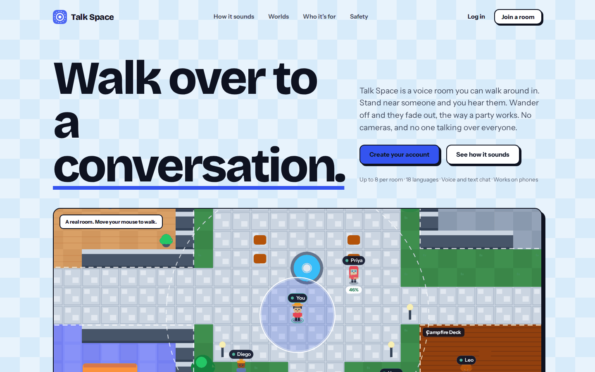
</p>

## What it is

Talk Space is a browser-based social audio app. Every room is a small pixel-art world (a courtyard, a beach, a night market…). You get an avatar and walk around with the keyboard, a click, or a joystick on your phone.

- **Close means clear.** Within 2 tiles you hear someone at full volume. Past that the sound drops off quickly and is gone at 7 tiles.
- **Zones mean privacy.** A café, a library or a campfire deck can be a _zone_: everyone inside hears each other at full volume, and the rest of the room goes quiet.
- **Straight to the room.** Voice and chat travel directly between participants (WebRTC). The server only helps people find each other and never sees the audio.

<p align="center">
  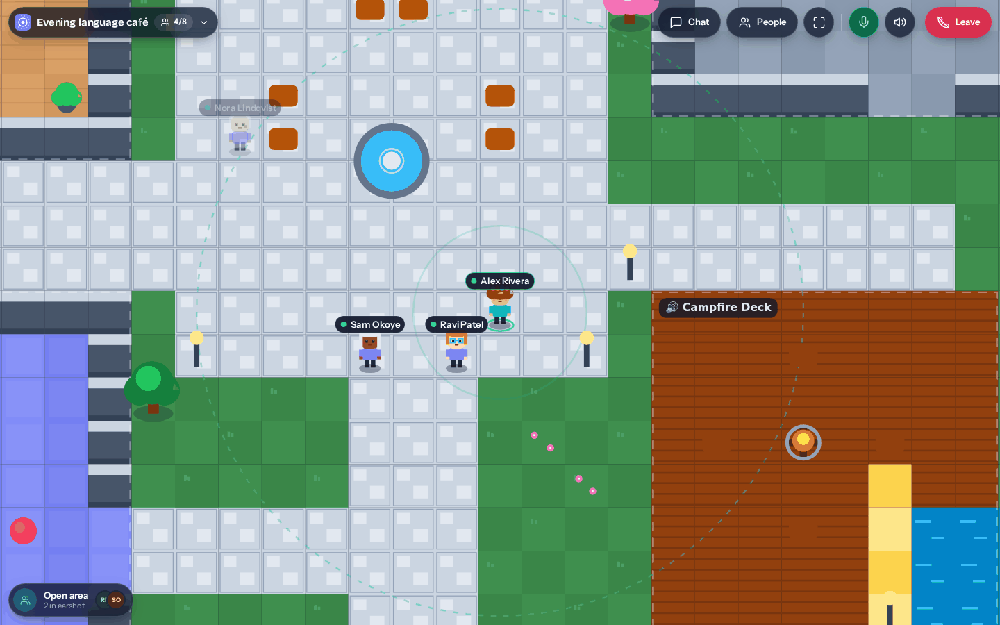<br>
  <sub>Inside a room. The ring is your hearing range; Nora is out of earshot, so she is greyed out.</sub>
</p>

## Screenshots

|                                                                     |                                                              |
| ------------------------------------------------------------------- | ------------------------------------------------------------ |
| 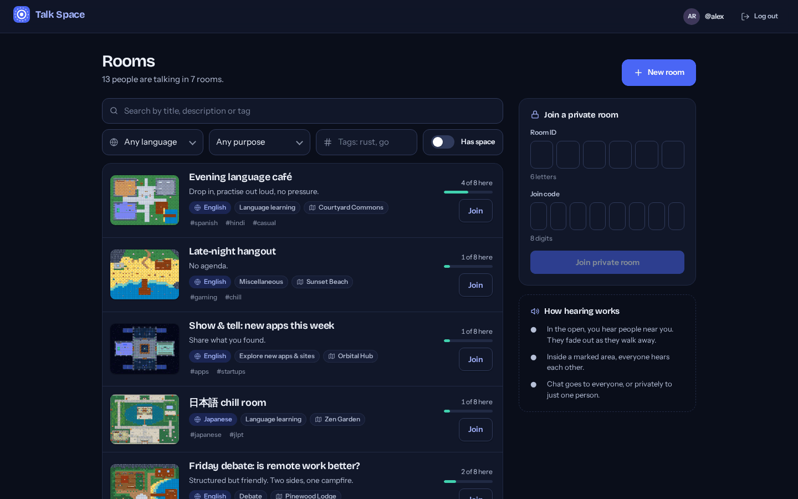                                | 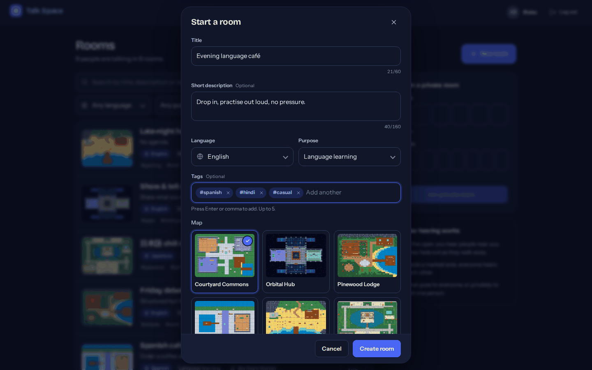           |
| **Lobby**: search and filter public rooms                           | **Create a room**: language, purpose, tags and a map         |
| 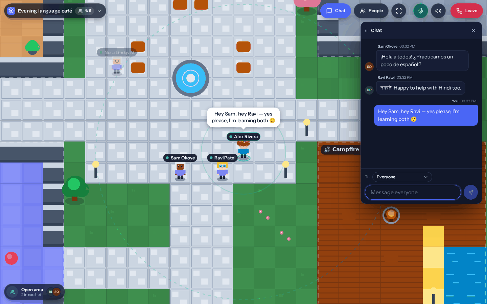                             | 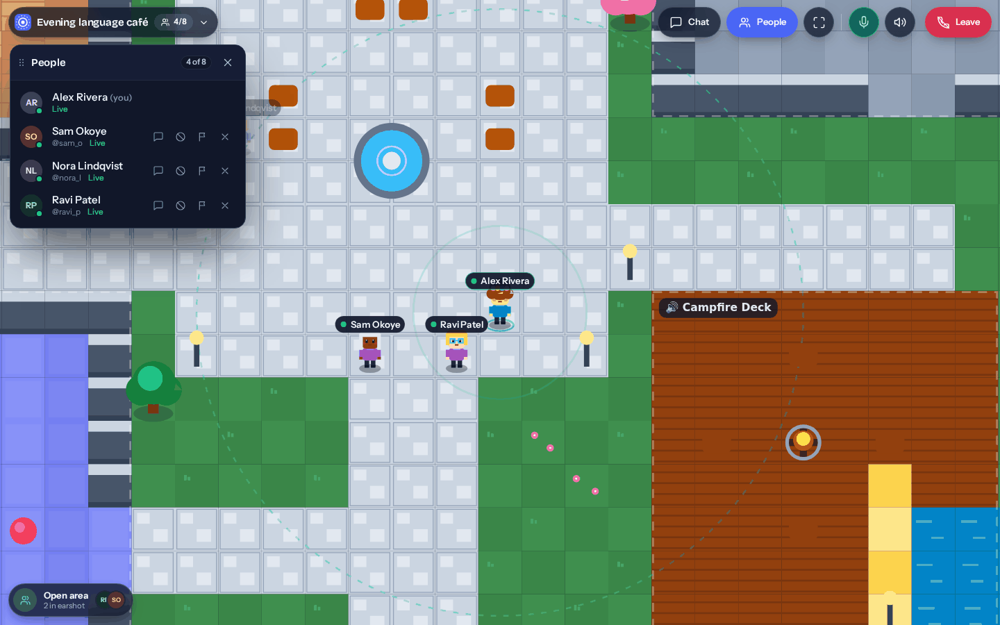                  |
| **Chat**: to everyone or privately, with speech bubbles             | **People**: message, block, report or remove someone         |
| 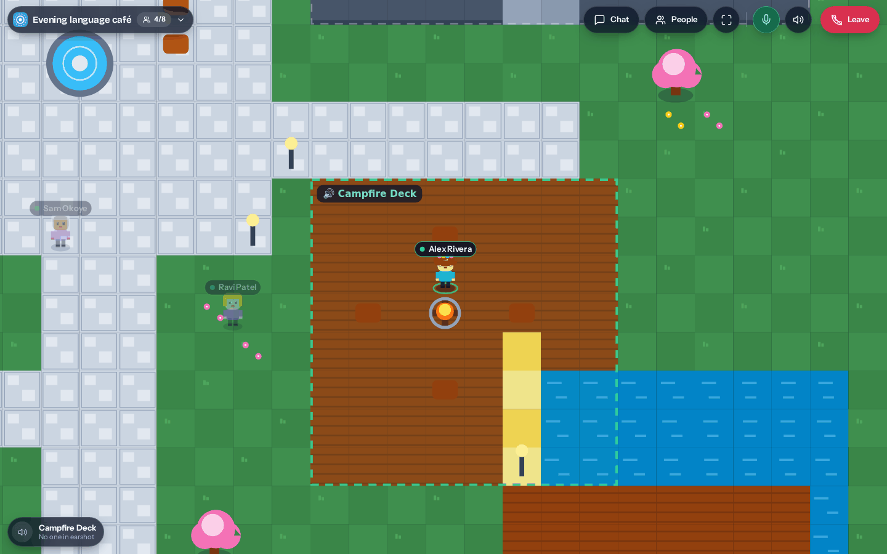                             | 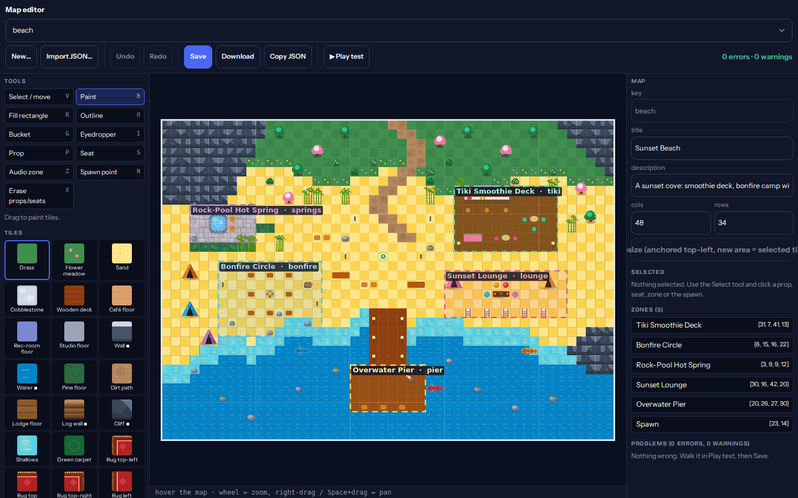               |
| **Zones**: inside the Campfire Deck the rest of the room goes quiet | **Map editor** (dev only): tiles, props and audio zones      |
| 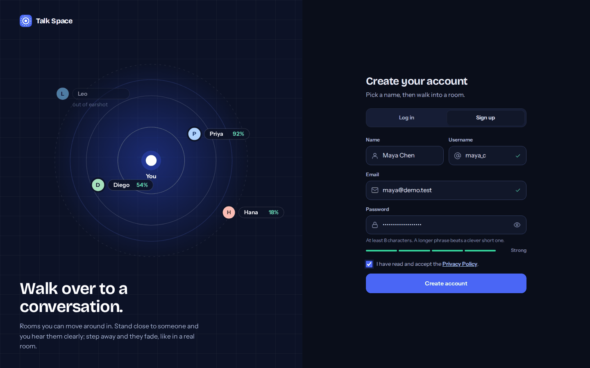                             | 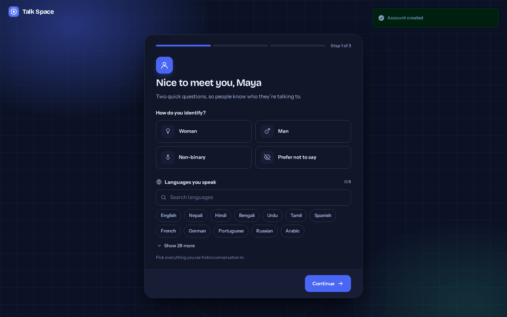               |
| **Sign up** with email and password (Google login is optional)      | **Onboarding**: languages, interests and skills              |

<p align="center">
  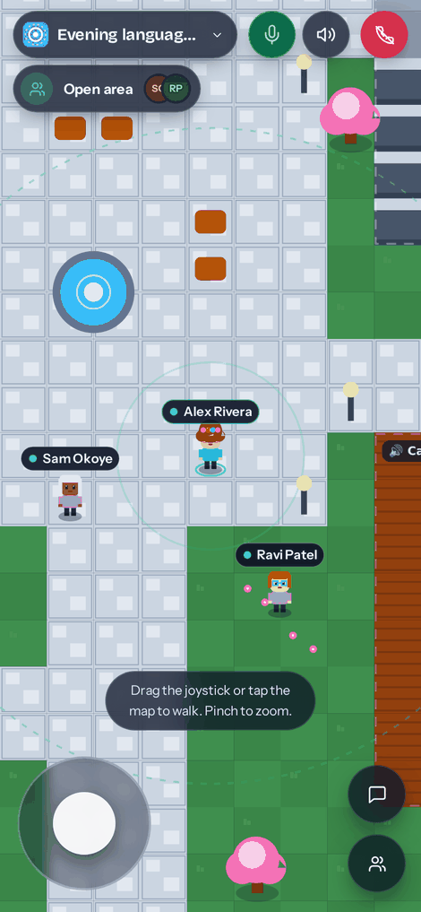<br>
  <sub>On a phone: drag the joystick or tap the map to walk, pinch to zoom.</sub>
</p>

> The screenshots were captured from a local dev instance with demo accounts.

## Features

- **Rooms**: up to 8 people each, in 18 languages, with a purpose (language learning, discussion, debate, explore, misc), up to 5 tags and a choice of 6 maps.
- **Public and private rooms.** Public rooms appear in the lobby while someone is inside. Private rooms need a 6-letter room ID plus an 8-digit join code, and repeated wrong guesses are blocked. Empty rooms disappear.
- **Voice and text chat**, with messages to everyone or privately to one person. Mute yourself, mute the room's sound, or join listen-only.
- **Safety tools**: block, report or (as host) remove someone. Reports land in an admin moderation queue (dismiss, strike, suspend, ban).
- **Privacy option**: hide your IP address by relaying all media through a TURN server.
- **Accounts**: email and password, or optional Google login. Short-lived JWTs that the web app refreshes in the background.
- **Profiles and onboarding**: spoken languages, interests, skills and a short bio.
- **Map editor and CLI**: maps are plain JSON files, with a visual editor (dev only) and a validator for CI.

## How it works

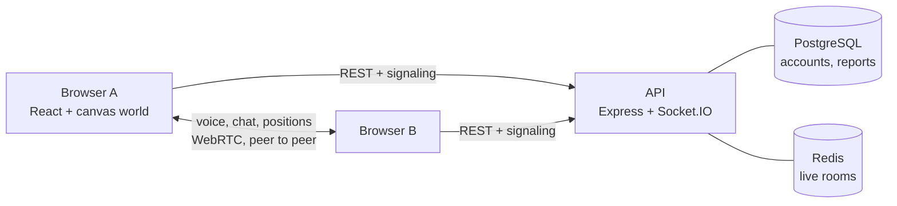

- **Peer to peer.** Each participant connects directly to the others in the room (hence the cap of 8). The API only relays the WebRTC handshake.
- **Hearing is computed on each listener's device** from the positions the peers share, using the rules in `apps/web/src/world/hearing.ts`.
- **Live room state lives only in Redis**, shared by every API instance through the Socket.IO Redis adapter. PostgreSQL stores accounts, profiles and reports.
- **The browser calls the API directly** (CORS, no proxy), the same way in development and in production: set `VITE_API_URL` on the web app and `WEB_URL` on the API.

## Tech stack

| Part             | Built with                                                                                                                  |
| ---------------- | --------------------------------------------------------------------------------------------------------------------------- |
| Monorepo         | pnpm workspaces, Turborepo                                                                                                  |
| Web (`apps/web`) | React 19, TypeScript, Vite, React Router, Zustand, Socket.IO client, a custom canvas world engine, WebRTC                    |
| API (`apps/api`) | Node.js, Express 5, TypeScript, Socket.IO (+ Redis adapter), Drizzle ORM, Zod, Helmet, better-auth (Google only), JWT       |
| Data             | PostgreSQL, Redis                                                                                                           |

## Project layout

```
apps/
  api/                 Express + Socket.IO server
    src/features/        auth, user, rooms, reports, admin (routes, controllers, services, schemas)
    src/realtime/        Socket.IO signaling and the room hub
    src/config/          rooms.config.ts, profile.config.ts: limits, languages, purposes
    src/db/              Drizzle schema
    tests/               integration tests (real PostgreSQL + Redis)
  web/                 React app
    src/pages/           landing, auth, onboarding, lobby, room, profile
    src/world/           engine, hearing model, maps (maps/data/*.map.json), map editor
    src/webrtc/          peer links and the network manager
    tools/               maps CLI and the dev-only map editor plugin
docker-compose.yml     PostgreSQL and Redis for local development
DEPLOY.md              production checklist
```

## Getting started

**You need:** Node.js 24 or newer, pnpm 11 (`corepack enable`), and Docker (for PostgreSQL and Redis).

```bash
# 1. Install
pnpm install

# 2. Start PostgreSQL and Redis
docker compose up -d postgres redis

# 3. Configure (the defaults work with the compose file)
cp apps/api/.env.example apps/api/.env
cp apps/web/.env.example apps/web/.env

# 4. Create the tables
pnpm --filter api db:migrate

# 5. Run everything (API on :3000, web app on :5173)
pnpm dev
```

Open <http://localhost:5173>, sign up, finish onboarding and create a room. To try it with two people, open a second browser profile (or a private window) and sign up as someone else.

> `docker-compose.yml` also defines a MinIO service. The app doesn't use it yet, so you can skip it.

### Testing on a phone

Browsers only allow the microphone on `https://` pages (and on `localhost`). To try it from a phone, serve both the web app and the API over https (a tunnel such as Cloudflare Tunnel, or a staging deployment) and set `VITE_API_URL` to the API's https address. `HTTPS=1 pnpm dev` serves the dev web app over https with a self-signed certificate, but the phone must also be able to reach the API over https.

## Configuration

### API (`apps/api/.env`)

See `apps/api/.env.example` for the full, commented list.

| Variable                                                | Purpose                                                                                                                          |
| ------------------------------------------------------- | -------------------------------------------------------------------------------------------------------------------------------- |
| `DATABASE_URL`, `REDIS_URL`                             | PostgreSQL and Redis connections (the defaults match `docker-compose.yml`)                                                       |
| `JWT_SECRET`, `BETTER_AUTH_SECRET`                      | Signing secrets. In production they must be random and 32+ characters, or the server refuses to start                            |
| `WEB_URL`                                               | Address of the web app. The only origin allowed to call the API (CORS)                                                           |
| `BETTER_AUTH_URL`                                       | The API's own public address (used for the Google redirect)                                                                      |
| `GOOGLE_CLIENT_ID`, `GOOGLE_CLIENT_SECRET`              | Optional Google login. Redirect URI: `<BETTER_AUTH_URL>/api/v1/better-auth/callback/google`                                      |
| `TRUST_PROXY`                                           | Number of reverse proxies in front of the API, so rate limits see real client addresses                                          |
| `ROOM_MAX_MEMBERS`, `SEAT_GRACE_SECONDS`                | Room size (default 8) and how long a dropped connection keeps its seat (default 15 s)                                            |
| `STUN_URLS`, `TURN_URLS`, `TURN_SECRET`, `FORCE_RELAY` | WebRTC connectivity. STUN is enough for most networks; add TURN for strict NATs or to hide IP addresses                          |

Room limits, languages and purposes live in `apps/api/src/config/rooms.config.ts`; onboarding limits live in `profile.config.ts`. The web app reads both from the API, so there is nothing to change twice.

For TURN, run [coturn](https://github.com/coturn/coturn) (or use a hosted TURN service) with `use-auth-secret` and `static-auth-secret` set to your `TURN_SECRET`. The API hands out short-lived credentials derived from that secret.

### Web (`apps/web/.env`)

| Variable       | Purpose                                                                                                                                         |
| -------------- | ----------------------------------------------------------------------------------------------------------------------------------------------- |
| `VITE_API_URL` | Where the API lives, as an origin: `http://localhost:3000` locally, `https://api.yourdomain.com` in production. Production builds fail without it |

## Scripts

| Command                                        | What it does                                                                                                                                       |
| ---------------------------------------------- | -------------------------------------------------------------------------------------------------------------------------------------------------- |
| `pnpm dev`                                     | Runs the API and the web app together                                                                                                              |
| `pnpm build`                                   | Builds both (`apps/api/dist`, `apps/web/dist`)                                                                                                     |
| `pnpm lint`                                    | Lints the workspace                                                                                                                                |
| `pnpm --filter api test`                       | API integration tests. They need PostgreSQL and Redis, **write test users and flush Redis database 15**, so point them at a disposable database    |
| `pnpm --filter api typecheck`                  | Type-checks the API                                                                                                                                |
| `pnpm --filter api db:generate` / `db:migrate` | Create / apply database migrations                                                                                                                 |
| `pnpm --filter api db:studio`                  | Browse the database with Drizzle Studio                                                                                                            |
| `pnpm --filter web test`                       | Web unit tests (audio, network, peer links, forms, profile)                                                                                        |
| `pnpm --filter web maps check`                 | Validates every map (use it in CI)                                                                                                                 |

## Making maps

A map is one JSON file in `apps/web/src/world/maps/data/`. Drop a file in and it appears in the "Create room" picker. There is no list to edit, and the API only stores the map's key.

- **Visual editor**: run `pnpm dev` and open <http://localhost:5173/dev/maps>. Paint tiles, place props and seats, draw audio zones, then _Play test_ and _Save_. The editor exists in development only.
- **Command line**: `pnpm --filter web maps spec` prints the file format and the tile and prop catalog; `maps new`, `maps apply` and `maps show` create and change maps.

More in [`apps/web/src/world/maps/README.md`](apps/web/src/world/maps/README.md).

## Deploying

In short: run the API somewhere that keeps WebSockets open, publish `apps/web/dist` as a static site, set `VITE_API_URL` for the web build, and set `WEB_URL` and `BETTER_AUTH_URL` on the API. Serve both over https, ideally on the same site (for example `app.example.com` and `api.example.com`). The full checklist is in [`DEPLOY.md`](DEPLOY.md).

## Troubleshooting

| Problem                                                  | Likely cause                                                                                                                  |
| -------------------------------------------------------- | ----------------------------------------------------------------------------------------------------------------------------- |
| `ECONNREFUSED` in the console right after `pnpm dev`     | The web app started before the API finished connecting to PostgreSQL and Redis. The web app retries on its own                |
| Requests blocked by CORS                                 | `WEB_URL` on the API doesn't exactly match the address in the browser (scheme, host and port; no path)                        |
| `429 Too Many Requests` while testing sign-up            | Per-IP rate limits. In development, wait or restart Redis; behind a proxy, set `TRUST_PROXY`                                  |
| No microphone prompt                                     | The page isn't on `https://` or `localhost`                                                                                   |
| People can't hear each other on some networks            | Strict NAT. Configure a TURN server (`TURN_URLS`, `TURN_SECRET`)                                                              |
